  

## Principles

- **Sharing is caring.** 
  Open code gets fixed, reused and extended by people who would never have found it otherwise. I learn as much from reading what others share as anyone might learn from my work. I don't share to get something back. It's how a community grows, and everyone ends up better for it.

- **Local over cloud.** 
  Software should run on hardware I control, keep data at home, and keep working when a service disappears or the internet goes down. Local means faster responses, no subscription that can change overnight, and no company deciding what happens to my data. The cloud has its uses, but it shouldn't be the only place things work.

- **Self-hosted over big tech.** 
  I pick open source and self-hosted options where it's reasonable. Open tools can be inspected, moved and kept alive by the community, even after the original author moves on. I'm pragmatic about it, and I still use big platforms where the people are, like GitHub.

## Support My Work

If you enjoy my projects or tools, you can support me here: 
